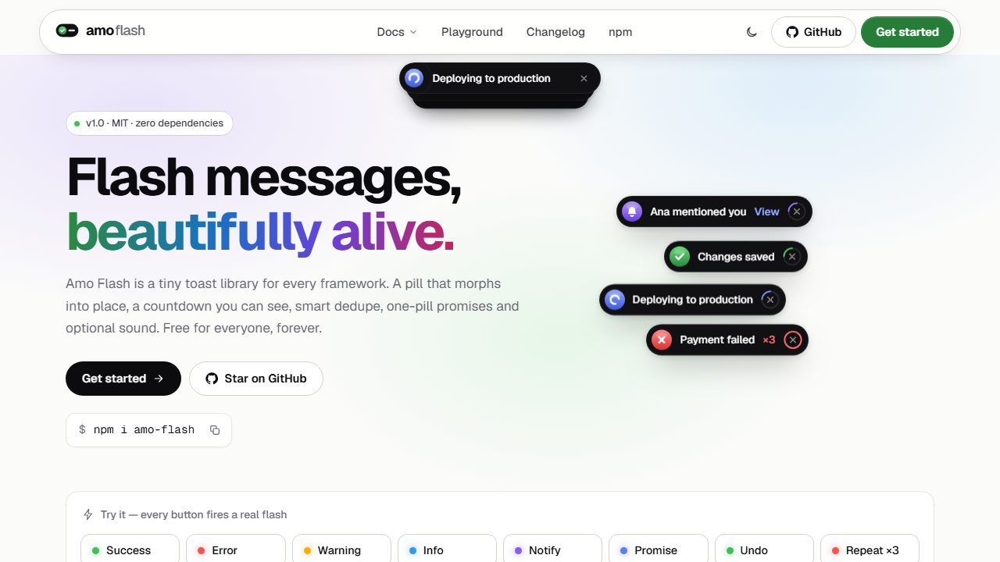

<div align="center">


# Amo Flash

**Flash messages, beautifully alive.**

A tiny, framework-agnostic toast library: a pill that morphs into place, a countdown you can see,
smart dedupe, one-pill promises and optional sound. Free for everyone, forever.

[](https://www.npmjs.com/package/amo-flash)
[](https://bundlephobia.com/package/amo-flash)
[](LICENSE)
[](https://github.com/dev-amolrakh/Amo-Flash/actions/workflows/ci.yml)
[](https://amo-flash.vercel.app)

[**Website & playground**](https://amo-flash.vercel.app) ·
[Docs](https://amo-flash.vercel.app/docs) ·
[Playground](https://amo-flash.vercel.app/playground) ·
[npm](https://www.npmjs.com/package/amo-flash) ·
[Changelog](CHANGELOG.md)

<picture>
  <source media="(prefers-color-scheme: dark)" srcset=".github/assets/preview-dark.png" />
  
</picture>

**[Try it live → amo-flash.vercel.app](https://amo-flash.vercel.app)**

</div>

## Why Amo Flash

- **One call.** `flash.success("Saved")`. The first flash mounts itself, so there is no provider to forget.
- **Feels alive.** Morph, drop, slide or fade entrances, an animated icon, and a smooth width morph when content changes.
- **A countdown you can see.** Six styles: close ring, icon ring, outline, sweep, edge glow and bar. Hovering or focusing pauses every timer.
- **No toast spam.** Repeats merge into one pill with a **×N** counter, and double-fires within 1.5 s are ignored.
- **Async in one pill.** `flash.promise()` goes from loading to success or error in place.
- **Works everywhere.** A plain TypeScript and DOM core, React / Vue / Svelte helpers, an Angular recipe, and a `<script>` build. SSR-safe.
- **Accessible.** Polite and assertive live regions, keyboard support, `Esc` to dismiss, labelled controls, and `prefers-reduced-motion`.
- **Yours to style.** Any background colour with automatic text contrast, CSS variables, six positions, and deck or list stacking.
- **Sound built in.** Five packs synthesized with Web Audio, so there are no audio files. On by default, and one switch mutes them.
- **Small.** About 13 kB gzipped for the script-tag build, CSS and sounds included. Zero dependencies.

## Install

```bash
npm install amo-flash
# pnpm add amo-flash · yarn add amo-flash · bun add amo-flash
```

## Quick start

```ts
import { flash } from "amo-flash";

flash.success("Saved");
flash.error("Couldn't save", { message: "Check your connection" });
flash.notify("New comment", { action: { label: "View", onClick: openComments } });

await flash.promise(saveProfile(), {
  loading: "Saving profile",
  success: "Profile saved",
  error: (err) => ({ title: "Save failed", message: String(err) }),
});
```

The stylesheet is injected automatically. With a strict CSP, set `injectStyles: false` and
`import "amo-flash/style.css"`.

## Frameworks

All entry points share **one queue**: `flash` from `amo-flash` and from `amo-flash/react` is the same object.

<details open>
<summary><b>React</b></summary>

```tsx
import { AmoFlash, flash } from "amo-flash/react";

export function App() {
  return (
    <>
      <AmoFlash position="top-center" />
      <button onClick={() => flash.success("Saved")}>Save</button>
    </>
  );
}
```

Hooks: `useFlash()`, `useFlashConfig()` (live config) and `useFlashes()` (live queue for custom UIs).

</details>

<details>
<summary><b>Next.js (App Router)</b></summary>

`amo-flash/react` ships with `"use client"`, so render it from your server layout:

```tsx
// app/layout.tsx
import { AmoFlash } from "amo-flash/react";

export default function RootLayout({ children }: { children: React.ReactNode }) {
  return (
    <html lang="en">
      <body>
        {children}
        <AmoFlash />
      </body>
    </html>
  );
}
```

</details>

<details>
<summary><b>Vue 3</b></summary>

```ts
import { createApp } from "vue";
import { createAmoFlash } from "amo-flash/vue";

createApp(App)
  .use(createAmoFlash({ position: "bottom-right" }))
  .mount("#app");

// any component
import { useFlash } from "amo-flash/vue";
useFlash().success("Saved"); // or this.$flash.success("Saved")
```

</details>

<details>
<summary><b>Svelte</b></summary>

```svelte
<script>
  import { onMount } from "svelte";
  import { flash, initFlash, flashConfig } from "amo-flash/svelte";

  onMount(() => initFlash({ position: "top-right" }));
</script>

<button on:click={() => flash.success("Saved")}>Save</button>
```

`flashConfig` is a writable store and `flashes` a readable one; both work with `$` in Svelte 3, 4 and 5.

</details>

<details>
<summary><b>Angular</b></summary>

```ts
import { Injectable } from "@angular/core";
import { configure, flash } from "amo-flash";

@Injectable({ providedIn: "root" })
export class FlashService {
  constructor() {
    configure({ position: "top-right" });
  }
  readonly show = flash;
}
```

</details>

<details>
<summary><b>Vanilla JS / CDN</b></summary>

```html
<script src="https://unpkg.com/amo-flash@1/dist/amo-flash.global.js"></script>
<script>
  const { flash, configure } = window.AmoFlash;
  flash.success("Hello from a script tag");
</script>
```

</details>

## API

| Method                                                                         | Description                                                                |
| ------------------------------------------------------------------------------ | -------------------------------------------------------------------------- |
| `flash.success / error / warning / info / notify(title, options?)`             | Show a flash. Returns its id.                                              |
| `flash.loading(title, options?)`                                               | A spinner that stays until updated or dismissed.                           |
| `flash.show(type, title, options?)`                                            | Any type, chosen at runtime.                                               |
| `flash.update(id, patch)`                                                      | Change type, title, message, action or duration in place.                  |
| `flash.promise(promise \| fn, { loading, success, error })`                    | Loading, then success or error, in one pill. Returns the original promise. |
| `flash.dismiss(id?)` / `flash.dismissAll()`                                    | Dismiss one flash, or all of them.                                         |
| `configure(partial)` / `getConfig()` / `resetConfig()` / `subscribeConfig(fn)` | Configuration.                                                             |
| `mountFlash(target?)` / `unmountFlash()`                                       | Optional manual mounting (for example into a custom container).            |
| `subscribe(fn)` / `getFlashes()` / `createFlashStore(deps)`                    | Headless access to the queue.                                              |
| `previewSound(pack, type?)`                                                    | Play a sound sample, for example in a settings screen.                     |

### Flash options

| Option      | Type                  | Description                                                                   |
| ----------- | --------------------- | ----------------------------------------------------------------------------- |
| `message`   | `string`              | Second line, shown when the pill expands on hover or focus.                   |
| `action`    | `{ label, onClick }`  | One inline button, such as Undo or View. Also dismisses the flash.            |
| `duration`  | `number \| "persist"` | Overrides the auto-dismiss time for this flash.                               |
| `id`        | `string`              | Stable id. Re-showing it updates the flash in place.                          |
| `dedupeKey` | `string`              | Flashes with the same key merge (×N). Default: `type\|title\|message`.        |
| `sound`     | `boolean`             | `false` never plays; `true` ignores `playFor` (the global switch still wins). |
| `source`    | `string`              | Free-form tag for headless renderers and logs.                                |

### Configuration

| Option                                             | Default        | Description                                                                                  |
| -------------------------------------------------- | -------------- | -------------------------------------------------------------------------------------------- |
| `position`                                         | `"top-center"` | `top-left`, `top-center`, `top-right`, `bottom-left`, `bottom-center` or `bottom-right`      |
| `stacking`                                         | `"deck"`       | `deck` fans out on hover; `list` is always expanded                                          |
| `maxVisible`                                       | `4`            | 1–10; the oldest is dismissed beyond this                                                    |
| `duration`                                         | `4500`         | Auto-dismiss in ms (×1.5 when there is an action)                                            |
| `errorsPersist`                                    | `true`         | Errors stay until dismissed                                                                  |
| `pauseOnHover`                                     | `true`         | Hover or focus pauses every timer                                                            |
| `closeButton` / `swipeToDismiss` / `expandOnHover` | `true`         | Interaction toggles                                                                          |
| `countdown`                                        | `"close"`      | `close`, `ring`, `outline`, `sweep`, `edge`, `bar` or `none`                                 |
| `entrance`                                         | `"morph"`      | `morph`, `drop`, `slide` or `fade`                                                           |
| `background`                                       | `null`         | Any `#rrggbb`; text flips to dark on light colours                                           |
| `theme`                                            | `"auto"`       | `auto` follows `.dark` / `data-theme` on `<html>`, else the OS                               |
| `offset` / `zIndex`                                | `16` / `9999`  | Distance from the edge (px) and stacking order                                               |
| `sound`                                            | on, `chime`    | `{ enabled, pack: "chime" \| "marimba" \| "pop" \| "bubble" \| "digital", volume, playFor }` |
| `labels`                                           | English        | `{ region, dismiss, times }`, for translation                                                |
| `persist`                                          | `false`        | localStorage key to remember end-user preferences                                            |
| `injectStyles`                                     | `true`         | Set to `false` to import `amo-flash/style.css` yourself                                      |

### Theming

```css
.af-viewport {
  --af-surface: #0b1020;
  --af-text: #ffffff;
  --af-action: #7dd3fc;
  --af-font: "Inter", sans-serif;
}
.af-pill[data-type="success"] {
  --af-accent: #22c55e;
}
```

## Accessibility

- Errors use `role="alert"` (assertive); everything else uses `role="status"` (polite).
- Focus inside the stack pauses timers and expands the pill. `Esc` dismisses the focused flash.
- Every type has its own icon shape, so colour is never the only signal.
- `prefers-reduced-motion` replaces every animation with a short fade.
- Text is always rendered as text (`textContent`), never as HTML.

## Browser support

Current Chrome, Edge, Firefox and Safari, desktop and mobile. Server rendering is safe: nothing touches `window`
until the first flash in the browser.

## This repository

```
Amo-Flash/
├── packages/amo-flash/   # the library (npm: amo-flash)
│   ├── src/              # core, DOM renderer, styles, sounds, React/Vue/Svelte adapters
│   └── test/             # Vitest + jsdom
└── apps/website/         # landing page, docs and playground (Vite + React)
    └── vercel.json       # website deployment (Vercel Root Directory = apps/website)
```

```bash
npm install
npm run dev         # website on http://localhost:5173 (uses the library source, hot reload)
npm test            # library tests
npm run typecheck
npm run build       # library (dist/) + website (apps/website/dist)
```

### Deploy the website to Vercel

The official site is live at **https://amo-flash.vercel.app**, deployed from `main`. To deploy your own copy:

1. In Vercel, choose **Add New → Project** and import the repository.
2. Set **Root Directory** to `apps/website`. Leave **Include files outside the root directory** turned on: the site builds from the library source in `packages/amo-flash`.
3. `apps/website/vercel.json` sets the framework (Vite), the install command (`npm ci`, which installs the whole workspace), the build command (`npm run build`) and the output directory (`dist`). Leave the build and install overrides in the dashboard turned off.
4. Use Node.js 22 or newer (Project → Settings → Build and Deployment → Node.js Version).

### Publish the library to npm

```bash
npm run build
cd packages/amo-flash
npm publish --access public
```

## Contributing

Issues and pull requests are welcome. Reproduce problems in the [Playground](https://amo-flash.vercel.app/playground) first if you can. See [CONTRIBUTING.md](CONTRIBUTING.md) and the [Code of Conduct](CODE_OF_CONDUCT.md).

## License

[MIT](LICENSE) © 2026 [dev-amolrakh](https://github.com/dev-amolrakh). Free for personal and commercial use.
